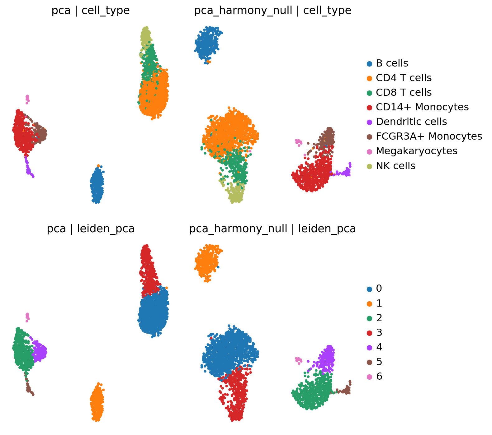
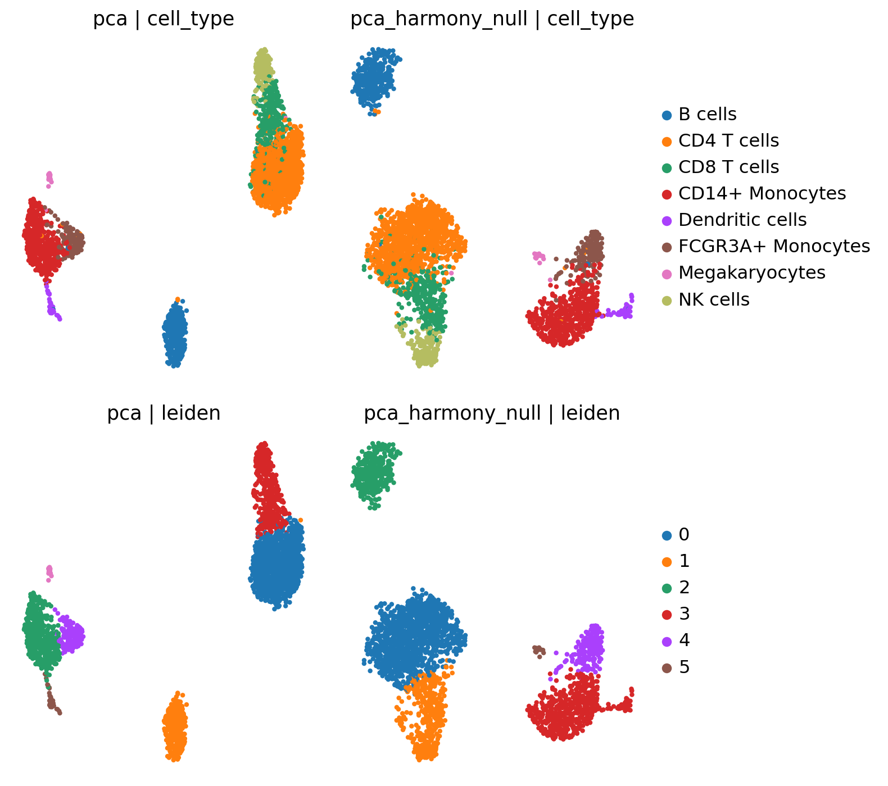
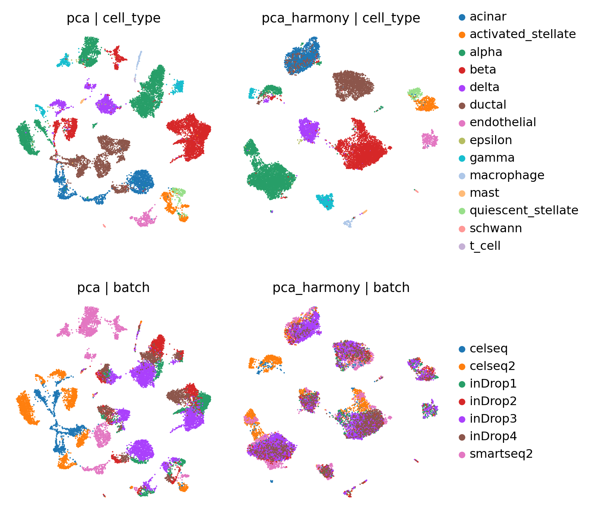
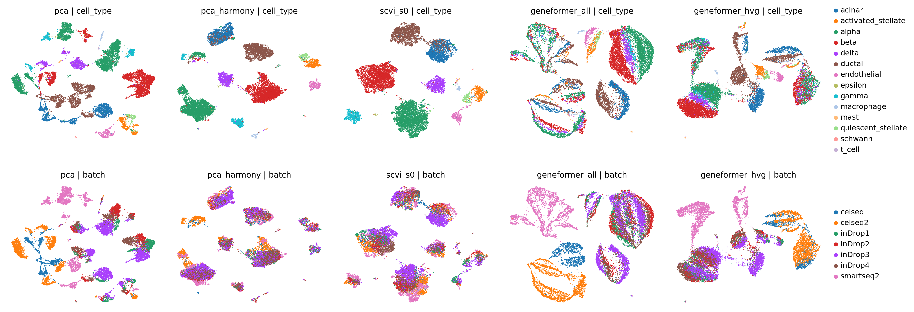
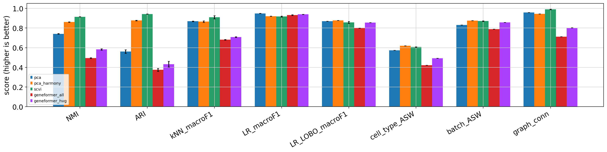
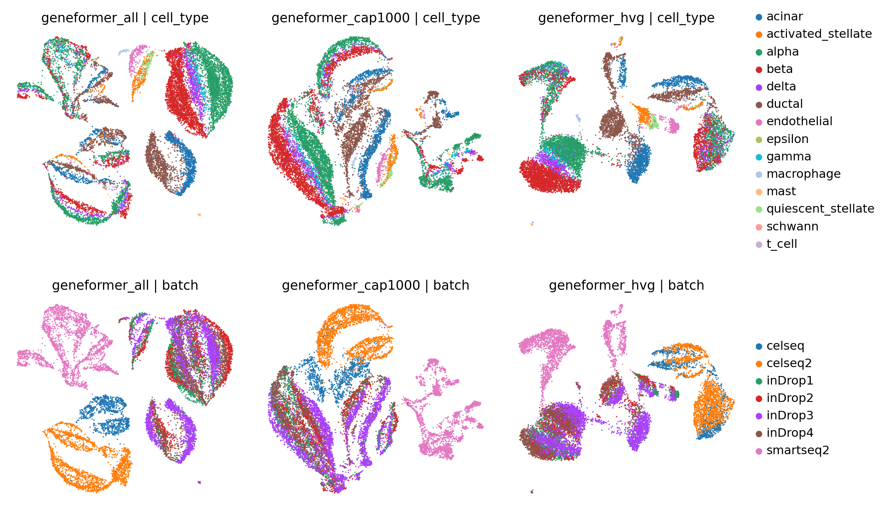

# Do foundation models beat classical pipelines on small scRNA-seq datasets?

A reproducible benchmark of cell embeddings for **batch integration** and **cell-type annotation**, built to run end to end in one free-tier Kaggle notebook (T4 GPU, ~16 GB RAM). Four embeddings are compared on the same cells, the same genes and the same scIB-style metrics: Scanpy PCA, PCA + Harmony, scVI, and zero-shot Geneformer.

> **Figures included:** The plots in [`results/figures/`](results/figures/) were extracted from saved outputs in the supplied original Kaggle notebook. The original notebook itself is not included as a verbatim upload; the repository contains the structured, documented notebook used for reproduction.

## Key takeaway

**No: zero-shot Geneformer did not beat the classical pipeline on this benchmark.** On the scIB human pancreas data (7 batches, 14,252 cells, 14 cell types) it came last on every clustering and geometry metric. The best method depends on the question:

| Question | Best | Runner-up and notes |
|---|---|---|
| Recovering cell types by clustering (NMI / ARI) | **scVI** (0.914 / 0.943) | Harmony 0.862 / 0.876, PCA 0.741 / 0.561, Geneformer 0.494 / 0.375 |
| Batch mixing (batch ASW, a lenient metric) | **Harmony** 0.876 | scVI 0.870, PCA 0.831 |
| Supervised annotation, mixed-batch CV (class-balanced logistic regression) | **plain PCA** 0.949 | Harmony 0.921, scVI 0.917; Geneformer 0.932-0.940 only at 768 dimensions (0.84 at 50) |
| Cross-batch label transfer (leave-one-batch-out) | **unclear** | ranking flips when the two rarest cell types are excluded (see below) |

Four findings worth knowing:

1. **Integration helps clustering, not annotation.** Harmony and scVI give much cleaner clusters, but a classifier trained across batches does just as well on uncorrected PCA.
2. **Geneformer's embedding mostly encodes how many genes a cell expresses.** Its first principal component correlates 0.96-0.98 (Spearman) with the number of tokens per cell inside five of the seven batches. Capping every cell at 1,000 tokens did not fix it, and neither did removing a suspicious gene (`TAAR5`).
3. **The pancreas file's `counts` layer is not uniform raw counts.** It mixes UMI counts, UMI-collision-corrected values, read counts and TPM-like values. Two batches were excluded (see Datasets).
4. **Harmony and scVI "mislabel" ductal cells that look acinar.** They send 159 and 108 of the 581 ductal cells in two batches to the acinar class, and those cells express acinar genes strongly (median acinar-module score about 2.2-2.5, against 0.0 for the ductal cells that were kept). This may be label noise, ambient RNA or doublets as much as integration failure. It is unresolved.

> [!NOTE]
> **Scope.** One dataset, one foundation model (Geneformer V2-104M), zero-shot only (no fine-tuning), and an own re-implementation of Geneformer's input encoding (see Limitations). Treat the Geneformer result as "zero-shot Geneformer in this setup", not as a verdict on foundation models.

## Question

Do deep generative (scVI) and foundation-model (Geneformer) embeddings beat a standard Scanpy + Harmony pipeline on a modest-sized, multi-batch scRNA-seq dataset with ground-truth labels, when judged by the same scIB-style metrics on the same cells and genes?

## Datasets

| Dataset | Cells | Batches | Role |
|---|---|---|---|
| PBMC3k (10x) | 2,638 | 1 | Sanity check only |
| scIB human pancreas | 14,252 (of 16,382) | 7 (of 9) | Main benchmark |

**Pancreas provenance.** Luecken et al., *Nature Methods* 2022 (scIB), figshare article 12420968, version 8 (DOI `10.6084/m9.figshare.12420968.v8`), file `human_pancreas_norm_complexBatch.h5ad`, 316.0 MB, MD5 `5aa155652b998c90395a0c9bd731b4b3`. The notebook downloads it through the figshare API and verifies the checksum.

**Audit of the `counts` layer, per batch:**

| Batch | Cells | Values in `counts` | Decision |
|---|---|---|---|
| inDrop1-4 | 8,569 | integer UMI counts (median library size about 5k) | used |
| celseq, celseq2 | 3,289 | non-integer, smallest value 1.001958, consistent with a UMI-collision correction | used, rounded to integers (max change 0.495) |
| smartseq2 | 2,394 | integer read counts (median library size about 288k) | used, flagged as read counts, not UMIs |
| fluidigmc1, smarter | 2,130 | TPM/RPKM-like values | **excluded** |

scVI needs count-like input and every method should see identical cells, hence the exclusion. No cell type is lost, and every type remains present in at least 4 of the 7 batches. The "collision correction" explanation is my interpretation of the numbers, not documented in the file.

**Cell types (14):** alpha 4,368; beta 3,439; ductal 2,106; acinar 1,648; delta 981; gamma 596; activated_stellate 448; endothelial 299; quiescent_stellate 192; macrophage 78; mast 39; epsilon 31; schwann 20; t_cell 7.

**PBMC3k labels are circular.** They come from the Scanpy tutorial's clustering of this same data with a classical pipeline, which favours classical methods.

## Methods

| Family | Method | Details |
|---|---|---|
| Classical | PCA | 50 components on the shared HVGs |
| Classical | PCA + Harmony | `harmonypy`, default parameters, on the 50 PCs |
| Deep generative | scVI (scvi-tools 1.5.2) | 2 layers, 30 latent dimensions, negative binomial; defaults, not tuned; 3 training seeds; early stopping, max 400 epochs |
| Foundation model | Geneformer V2-104M, zero-shot | all vocabulary genes (main run) and the 2,000 HVGs (sensitivity run) |

**Shared preprocessing.** Batch-aware `seurat_v3` selection of 2,000 HVGs on raw counts, `normalize_total` (1e4), `log1p`, scaling (clip at 10), PCA. The same HVG list feeds PCA, Harmony and scVI. Geneformer's main run uses all genes that map to its vocabulary (18,179 of 19,093 genes, 96.3% of counts), which is how the model is meant to be used and a deliberate departure from the shared-HVG rule; its sensitivity run uses the shared HVGs.

**Geneformer implementation.** The official `geneformer` package does not import under the Kaggle image's transformers 5.16.1 (`SpecialTokensMixin` was removed), so only the dictionary files and weights are downloaded and the input encoding is re-implemented: counts divided by the cell total, scaled to 10,000, divided by the gene's median, genes ranked in descending order, `<cls>` ... `<eos>`, 4,096 positions. The cell embedding is the mean over gene tokens of the second-to-last layer. The encoding follows the official tokenizer's logic; the pooling choices follow the extractor's documented options but were **not verified against the official code**.

**Graph, UMAP, clustering.** kNN graph (k = 15), UMAP, then Leiden over a resolution grid from 0.05 to 1.8; as in scIB, the resolution with the best NMI against the labels is used for ARI and NMI.

## Metrics

| Metric | Measures | Notes |
|---|---|---|
| ARI, NMI | agreement of Leiden clusters with labels | best-NMI resolution (scIB convention) |
| Cell-type ASW | label separation, rescaled to [0, 1] | |
| Batch ASW | batch mixing within cell types, 1 = well mixed | own implementation of the scIB definition |
| Graph connectivity | whether each cell type stays one connected group in the kNN graph | own implementation of the scIB definition |
| kNN macro-F1 | annotation, k = 15, stratified 5-fold CV | |
| Balanced LR macro-F1 | annotation, class-balanced logistic regression on standardised features, stratified 5-fold CV | |
| Leave-one-batch-out macro-F1 | annotation transferred to an unseen batch | deterministic, single value |

**Replicates.** Three seeds, mean ± sd. The seed varies Leiden and the CV folds; for scVI it also varies training (each training seed is evaluated with the matching seed). PCA, the neighbour graph, Harmony and Geneformer inference are deterministic, so metrics that depend only on them have no sd. The scVI retrain reproduced the earlier run exactly (same validation ELBO per seed), though that is two runs, not a guarantee.

## Results

### Pancreas, 7 batches, 14,252 cells (mean ± sd over 3 seeds; no sd = deterministic)

| Method | NMI | ARI | kNN F1 | Balanced LR F1 | Cell-type ASW | Batch ASW | Graph conn. | Leave-one-batch-out F1 |
|---|---|---|---|---|---|---|---|---|
| PCA | 0.741 ± 0.003 | 0.561 ± 0.018 | 0.869 ± 0.003 | **0.949** ± 0.001 | 0.573 | 0.831 | 0.958 | 0.869 |
| PCA + Harmony | 0.862 ± 0.002 | 0.876 ± 0.002 | 0.866 ± 0.008 | 0.921 ± 0.002 | **0.620** | **0.876** | 0.945 | **0.877** |
| scVI | **0.914** ± 0.001 | **0.943** ± 0.002 | **0.910** ± 0.016 | 0.917 ± 0.005 | 0.607 ± 0.003 | 0.870 ± 0.004 | **0.989** ± 0.002 | 0.857 ± 0.010 |
| Geneformer (all genes) | 0.494 ± 0.004 | 0.375 ± 0.015 | 0.681 ± 0.003 | 0.932 ± 0.005 | 0.422 | 0.789 | 0.711 | 0.798 |
| Geneformer (2,000 HVGs) | 0.582 ± 0.007 | 0.433 ± 0.029 | 0.709 ± 0.004 | 0.940 ± 0.001 | 0.492 | 0.856 | 0.803 | 0.856 |

Geneformer embeddings have 768 dimensions, PCA and Harmony 50, scVI 30. A linear classifier has more capacity on 768 dimensions, so the logistic-regression column is not dimension-matched (see the sensitivity table).

> **Figure files:** The saved UMAP and metric plots are included in [`results/figures/`](results/figures/). Re-running the notebook can regenerate them; UMAP layouts and clustering labels may differ with the runtime environment or settings.

### Geneformer sensitivity checks

| Variant | NMI | ARI | kNN F1 | Balanced LR F1 | Batch ASW | Graph conn. | Leave-one-batch-out F1 |
|---|---|---|---|---|---|---|---|
| All genes (main) | 0.494 | 0.375 | 0.681 | 0.932 | 0.789 | 0.711 | 0.798 |
| Capped at 1,000 tokens | 0.460 | 0.145 | 0.645 | not run | 0.822 | 0.772 | not run |
| Capped at 1,000 tokens, without `TAAR5` | 0.454 | 0.149 | 0.645 | not run | 0.822 | 0.764 | not run |
| All genes, reduced to 50 PCs | 0.491 | 0.378 | 0.629 | 0.836 | 0.751 | 0.704 | 0.682 |
| 2,000 HVGs, reduced to 50 PCs | 0.560 | 0.385 | 0.732 | 0.843 | 0.820 | 0.801 | 0.780 |

- **Token count.** PC1 of the all-genes embedding correlates 0.96-0.98 with tokens per cell inside `celseq` and `inDrop1-4`, 0.79 inside `celseq2` and 0.41 inside `smartseq2` (the last two are mostly capped at 4,096 tokens, so they have many ties).
- **Capping did not help.** Batch mixing and graph connectivity improved slightly, but cell-type recovery got worse. The capped run's best resolution reached the grid maximum (1.8, 45 clusters), so its NMI/ARI are lower bounds; kNN F1 does not depend on the resolution and is also lower.
- **`TAAR5`** has a Genecorpus median about 100 times below the typical gene (0.010 vs 1.1) and abundant counts in 11.7% of cells, so median scaling ranks it first in many cells. The source file, not my gene mapping, is the origin (a direct, unique symbol match). Removing it changes nothing beyond noise.
- **Dimension matching** lowers Geneformer's logistic-regression score from 0.93-0.94 to 0.84. Reducing to 50 PCs may also discard cell-type information stored in low-variance directions.

### What each method preserved or lost

- **Rare types.** `epsilon` (31 cells) is scattered in PCA (graph connectivity 0.45, kNN F1 0.06), improves under Harmony (0.74, 0.28), and is recovered by scVI (0.94, 0.93); Geneformer keeps it fragmented (0.26). scVI's kNN advantage over PCA and Harmony comes almost entirely from this one type. `t_cell` (7 cells) is the reverse: balanced-LR F1 0.80 (PCA), 0.71 (Harmony), 0.50 (scVI).
- **Fragmentation.** Geneformer (all genes) breaks several large types into pieces (graph connectivity 0.58 for acinar, 0.77 for alpha, 0.67 for activated stellate) and `gamma` (about 0.42); Harmony fragments `gamma` (0.81) and `t_cell` (0.86).
- **Ductal cells in inDrop2 and inDrop4.** These two batches contain almost no acinar cells (3 and 2). Of their 581 ductal cells, kNN labels 567 ductal and 8 acinar under PCA, 416 ductal and 159 acinar under Harmony, 469 ductal and 108 acinar under scVI, and only 43 and 34 acinar under the two Geneformer runs. The relabelled cells have a median acinar-module score of 2.24 (Harmony) and 2.51 (scVI), against 0.00 for the ductal cells that were kept and 0.18 for ductal cells in other batches. They are acinar-like by expression, so I cannot call these pure integration errors: uncorrected PCA "gets them right" partly because their within-batch neighbours share the batch's label. Whether they reflect mislabelling, ambient RNA or doublets is not resolved.
- **Marker genes** (Wilcoxon test) support the labels: INS, SST, PPY, GHRL, PRSS1, KRT19, PLVAP and SOX10 rank first for their own cell type, GCG second (after TTR), TPSAB1 third, COL1A1 fourth, CD68 sixth, RGS5 33rd for quiescent stellate cells, and CD3E 89th for `t_cell` (only 7 cells). Full table: `results/pancreas_top_markers.csv`.

### Robustness to the two rarest cell types

Dropping `t_cell` (7 cells) and `schwann` (20) reorders the cross-batch result:

| Leave-one-batch-out macro-F1 | PCA | Harmony | scVI | Geneformer (all) | Geneformer (HVG) |
|---|---|---|---|---|---|
| All 14 types | 0.869 | **0.877** | 0.857 | 0.798 | 0.856 |
| 12 types with at least 30 cells | 0.884 | 0.899 | **0.910** | 0.798 | 0.869 |

So integration gives a small (0.015-0.026) cross-batch benefit on well-populated types that a handful of rare cells can erase. On the 12-type stratified-CV scores, kNN F1 is 0.897 (PCA), 0.907 (Harmony), 0.962 (scVI), 0.758 and 0.774 (Geneformer), and balanced LR F1 is 0.958, 0.933, 0.942, 0.938 and 0.949. These per-class numbers use one seed and a single leave-one-batch-out run, without uncertainty estimates.

### PBMC3k sanity check (single batch)

Harmony run on random pseudo-batches (null control): cell-type ASW 0.569 vs 0.570 and kNN F1 0.901 vs 0.902, so Harmony leaves the embedding essentially unchanged. ARI/NMI differ (0.862 vs 0.835 and 0.844 vs 0.826) only because the best-NMI Leiden resolution differed (0.6 vs 0.4). One seed, resolution grid 0.2-1.8.

### Runtime (Kaggle T4)

Geneformer V2-104M (103.8M parameters) embedded all 14,252 cells in 15.8 min (all genes) and 1.0 min (HVG only), with 2.7 GB peak GPU memory. scVI trained in about 3 minutes per seed (140-159 epochs with early stopping). Two T4s are visible on Kaggle; one is used.

## Figures

These images are preserved from the saved PNG outputs in the supplied original Kaggle notebook. They are included as standalone files so they render in the GitHub repository and can be reused in presentations or reports. They were extracted without changing the plotted data or image pixels. The two PBMC3k outputs are kept separately because their saved Leiden panels show different cluster counts (7 and 6); they are not presented as a newly rerun comparison.

### PBMC3k Harmony null-control outputs

PCA and pseudo-batch Harmony UMAPs, coloured by cell type and saved Leiden labels.





### Pancreas embedding visualisations

PCA and PCA + Harmony UMAPs, coloured by cell type and batch.



UMAP comparison across PCA, Harmony, scVI, and Geneformer embeddings, coloured by cell type and batch.



### Quantitative benchmark and Geneformer sensitivity

Metric comparison across the five main embedding configurations.



UMAP comparison for Geneformer all-gene, 1,000-token-capped, and HVG configurations.



## Limitations

- **One dataset, one foundation model, zero-shot only.** No fine-tuning, and no scGPT (its setup was not attempted on this Python 3.13 / transformers 5 image).
- **Geneformer re-implementation.** The official package could not be imported, so the encoding is my own (tokenisation logic checked against the official source, pooling not verified). Small differences from the official pipeline are possible.
- **Metrics.** Batch ASW and graph connectivity are my implementations of the scIB definitions and have not been cross-checked against `scib-metrics`. iLISI and cLISI are not reported.
- **Leiden grid edges.** Harmony's best resolution is the grid minimum (0.05, giving 11 clusters, fewer than the 14 types); the capped Geneformer runs reached the grid maximum.
- **Rare types make macro-F1 noisy.** `t_cell` has 7 cells. Differences below about 0.03 in macro-F1 can come from one rare type, and the leave-one-batch-out ranking is not robust to them.
- **Default parameters.** Harmony (theta = 2) and scVI were not tuned, and scVI's count model does not fit the `smartseq2` read counts or the rounded CEL-seq values well.
- **Dimension mismatch.** Embeddings have 768, 50 and 30 dimensions; only the 50-PC Geneformer sensitivity run is dimension-matched.
- **Data handling.** Two batches were excluded, two were rounded, and `smartseq2` holds read counts, not UMIs.
- **Not a size study.** About 14k cells is modest, not small, and no experiment varies dataset size.

## Notebook files

- **[`notebooks/scrna_embedding_benchmark.ipynb`](notebooks/scrna_embedding_benchmark.ipynb)** — the structured, documented notebook used for the reproduction steps and result descriptions in this README. It writes/uses the helper module in `src/scbench.py`.

The supplied original Kaggle notebook was used as the source for the saved PNG outputs in `results/figures/`. It is intentionally not copied into this repository as-is. The figure files are referenced from this README and from the structured notebook, so GitHub can display them without relying on large embedded notebook outputs.

## How to reproduce

1. Create a Kaggle notebook and enable **Internet** plus the **GPU T4** accelerator. Upload `notebooks/scrna_embedding_benchmark.ipynb`, then select **Run All**. The reported run took roughly 2–3 hours; actual time depends on Kaggle availability and cache state.
2. The notebook downloads the pancreas dataset from Figshare, verifies its MD5 checksum, and downloads Geneformer dictionaries and model weights from Hugging Face. No raw dataset or model weights need to be committed to GitHub.
3. The notebook writes its `scbench.py` helper into `/kaggle/working/` from a notebook cell. The matching source copy is also available at `src/scbench.py` for inspection and local development; the notebook can be run on Kaggle without separately uploading this file.
4. Outputs are written to `/kaggle/working/results/`; intermediate embeddings and caches are stored under `/kaggle/temp/cache`. The final notebook cell lists the files to download. Copy generated CSVs and figures into this repository's `results/` folder only when you want to publish them. Large `.npy` embedding files are excluded by `.gitignore`.
5. The tested environment was Python 3.13.15 on the Kaggle image (2026-11-01). Exact package versions are recorded in `requirements.txt`. On Kaggle, do not reinstall NumPy, pandas, scikit-learn or PyTorch; those are preinstalled in the target image. The official Geneformer package is **not** installed.
6. Seeds are fixed (`SEED = 0`, replicates 0, 1 and 2). GPU runs may not be bit-for-bit repeatable in every environment.

The result tables in this README describe the reported Kaggle run. The structured notebook and helper module are included as source. The figures in `results/figures/` are saved visual outputs extracted from the supplied original notebook; the other result tables and CSV outputs can be regenerated by running the notebook.

## Repository layout

```
.
├── README.md
├── requirements.txt
├── .gitignore
├── notebooks/
│   └── scrna_embedding_benchmark.ipynb # structured reproduction notebook
├── src/
│   └── scbench.py                      # helper module
└── results/
    ├── README.md                       # notes on results and generated files
    └── figures/                        # saved visual outputs extracted from the original notebook
```

**What is not committed:** raw `.h5ad` datasets, model weights, downloaded dictionaries, runtime caches and large embedding arrays. The notebook retrieves the required source data and model assets when run. Generated summary CSVs can be added to `results/` after reproduction. The current `results/figures/` folder contains saved PNG outputs extracted from the supplied notebook.

## Roadmap

- [x] PBMC3k sanity check and Harmony null control
- [x] Pancreas data audit, exclusions and checksum
- [x] PCA, PCA + Harmony, scVI (3 training seeds) and zero-shot Geneformer, same metrics
- [x] Geneformer sensitivity checks (token count, token cap, `TAAR5`, dimension match)
- [x] Marker genes, per-type results and rare-type robustness
- [ ] Clean Restart & Run All of the consolidated notebook, then commit `results/`
- [ ] Cross-check batch ASW and graph connectivity against `scib-metrics`; add iLISI and cLISI
- [ ] Resolve the ductal/acinar puzzle (ductal-module scores, doublet scores)
- [ ] Harmony parameter sensitivity; wider Leiden grid
- [ ] Other foundation models (scGPT) or fine-tuning

## References

- Luecken, M.D. et al. Benchmarking atlas-level data integration in single-cell genomics. *Nature Methods* 19, 41-50 (2022).
- Korsunsky, I. et al. Fast, sensitive and accurate integration of single-cell data with Harmony. *Nature Methods* 16, 1289-1296 (2019).
- Lopez, R. et al. Deep generative modeling for single-cell transcriptomics. *Nature Methods* 15, 1053-1058 (2018).
- Gayoso, A. et al. A Python library for probabilistic analysis of single-cell omics data. *Nature Biotechnology* 40, 163-166 (2022).
- Theodoris, C.V. et al. Transfer learning enables predictions in network biology. *Nature* 618, 616-624 (2023). Model repository: https://huggingface.co/ctheodoris/Geneformer
- Kedzierska, K.Z. et al. Zero-shot evaluation reveals limitations of single-cell foundation models. *Genome Biology* (2025), doi:10.1186/s13059-025-03574-x
- Wolf, F.A., Angerer, P., Theis, F.J. SCANPY: large-scale single-cell gene expression data analysis. *Genome Biology* 19, 15 (2018).
